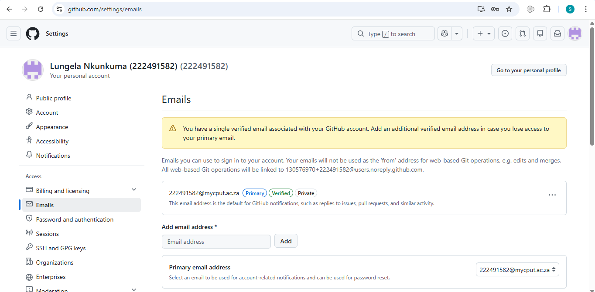

# 222491582.github.io

# Lungela Nkunkuma - Digital Portfolio

**Student Number:** 222491582  
**Course:** Diploma in Information and Communication Technology (Applications Development)  
**Institution:** Cape Peninsula University of Technology (CPUT)

---

## 📑 Table of Contents
1. [About Me & Contact](#about-me--contact)
2. [Education](#education)
3. [Technical Skills](#technical-skills)
4. [Work Experience](#experience)
5. [Projects](#projects)
6. [Multimedia & Evidence](#multimedia--evidence)
7. [Portfolio Reflections](#portfolio-reflections)
8. [Agile Project: iGugulam Community Programme](#agile-project-igugulam-community-programme)
    * [Agile Team Charter](#agile-team-charter)
    * [Product Backlog](#product-backlog)
    * [Sprint Backlog](#sprint-backlog)
    * [Agile User Stories & Tasks](#agile-user-stories--tasks)
    * [Agile Logbook](#agile-logbook)
    * [Agile Project Reflections](#agile-project-reflections)

---

## About Me & Contact

**Location:** Cape Town, South Africa  
**Phone:** +27 74 288 4834  
**Email:** 222491582@mycput.ac.za

I am a hardworking and passionate individual with a strong interest in technology. I have programming experience and enjoy problem-solving and building practical solutions. I have strong communication skills, work well in a team, and I am always eager to learn and explore new technologies. I am open to on-site, hybrid, or remote opportunities.

---

## Education

**Cape Peninsula University of Technology (CPUT)**  
*Diploma in Information and Communication Technology: Applications Development*  
Current Student  

**Hoërskool Uitsig**  
Pretoria, Gauteng — 2021  

---

## Technical Skills

*   **Programming Languages:** Java, Python, JavaScript
*   **Web Technologies:** HTML, CSS
*   **Database:** SQL
*   **Frameworks / Platforms:** Android, UiPath (RPA)
*   **Tools & IDEs:** Visual Studio Code, IntelliJ IDEA, Git

---

## Experience

**FirTech (Pty) Ltd — RPA Developer (Vacation Work)**  
*Sandton, Gauteng — 2026*
*   Shadowed RPA developers while completing the RPA Associate learning pathway
*   Built automation workflows using UiPath Studio
*   Used UiPath Orchestrator to deploy and monitor processes
*   Gained understanding of RPA architecture and lifecycle
*   Debugged and tested automation solutions
*   Worked within the UiPath ecosystem

**McDonald's South Africa — Technical Support (Vacation Work)**  
*Sandton, Gauteng — 2025*
*   Provided first-line IT support and troubleshooting
*   Assisted with system monitoring and user access management
*   Collaborated with IT specialists
*   Set up devices and installed software
*   Helped onboard new employees with technical systems
*   Managed help desk support tasks (Ticket handling and escalation, User support, Account management)

*References available upon request.*

**Ronald McDonald House Charities — Volunteer**  
*Johannesburg — 2020*
*   Assisted families with sick children
*   Provided kitchen and cleaning support
*   Assisted with admin and meal preparation

---

## Projects

**Book E-Commerce Web Application**  
*CPUT Project — 2025*  
*Technologies: Java, MySQL, HTML, CSS, JavaScript, JSON*
*   Built a full-stack book buying/selling platform
*   Implemented user registration and login
*   Designed database for users and transactions
*   Applied OOP and multi-layer architecture
*   Created a clean UI using HTML/CSS/JS

**Car Repair Shop Management System**  
*CPUT Project — 2025*  
*Technologies: React, Java, MySQL, JSON*
*   Built frontend using React
*   Developed backend logic in Java
*   Implemented CRUD operations
*   Integrated database with MySQL
*   Designed user-friendly navigation

---

## Multimedia & Evidence

*   [Click here to watch my mock interview video](Lungela_Nkunkuma_222491582_Mock_Interview_Video.mp4)

**GitHub Student Account Evidence**
The screenshot below confirms that my GitHub account is registered using my student email address.

---

## Portfolio Reflections

### Reflection on Coding in Markdown
**Situation:** I needed to create and present my CV in Markdown format on GitHub.
**Task:** My task was to learn the basics of Markdown syntax and use it to organise my CV into a professional digital format.
**Action:** I researched how Markdown works and used headings, bullet points, sections, and formatting syntax to structure my CV clearly.
**Result:** I successfully created a clean and professional CV. This strengthened my understanding of Markdown and how simple tools can present professional information online.

### Reflection on Mock Interview Video
**Situation:** I was required to create and embed a mock interview video into my digital portfolio.
**Task:** Prepare for a mock interview, present myself professionally, and upload the video.
**Action:** I prepared responses, practised speaking clearly, recorded the video, and linked it within my GitHub portfolio.
**Result:** This improved my confidence in presenting myself professionally and taught me how multimedia elements can be integrated into an online portfolio.

### Reflection on the Use of GitHub Pages
**Situation:** I needed to publish my work online using GitHub Pages.
**Task:** Configure GitHub Pages correctly so my portfolio could be hosted and accessed through a public web link.
**Action:** I created the repository, uploaded my files, enabled GitHub Pages in the settings, and tested the published site.
**Result:** I successfully published my digital portfolio online and gained practical experience using GitHub Pages for web hosting.

---

# Agile Project: iGugulam Community Programme

The iGugulam Community Programme is an after-school homework support program created to help learners in Gugulethu succeed academically in a safe and supportive environment. Our team was tasked with designing and developing a digital solution (website) for this program.

## Agile Team Charter

**1. Title Slide & Team Members**

**2. Team Purpose & Vision**

**3. Team Roles & Responsibilities**

**4. Guiding Principles (Values & Agile Principles)**

**5. Communication Plan**

**6. Goals, Milestones & Timeline**

**7. Research & Planning**

**8. Design & Development**

---

## Product Backlog

The Product Backlog is a prioritized list of all required work, features, and improvements needed for the iGugulam website.

**Evidence: Product Backlog (Trello)**

---

## Sprint Backlog

The Sprint Backlog is the real-time, actionable plan created by and for developers that outlines the specific work needed to achieve the sprint goal.

**Evidence: Sprint 1 & 2 (Research & Planning)**

**Evidence: Sprint 3, 4 & 5 (Design & Architecture)**

**Evidence: Sprint 6 & 7 (Development)**

---

## Agile User Stories & Tasks

In line with Agile methodology, our requirements are captured as User Stories. Each story includes a Priority, a Story Point Estimate, Acceptance Criteria (to define "Done"), and the specific Tasks required to build it.

**User Story 1: Online Learner Registration**
*   **As a** Parent/Guardian
*   **I want to** register my child online for the after-school programme
*   **So that** I can secure their spot and ensure they have a safe place to go after school.
*   **Priority:** High | **Story Points:** 5
*   **Acceptance Criteria:**
    *   The form must capture Parent Name, Contact Number, Learner Name, and Grade.
    *   The system must validate that all required fields are filled.
    *   A success message must appear upon submission, and data must be saved to the MySQL database.
*   **Tasks:**
    *   [x] Design registration form UI.
    *   [x] Create HTML/CSS front-end layout.
    *   [x] Build Java/MySQL backend to receive and store data.
    *   [x] Implement form validation (JavaScript).
    *   [x] Test registration flow.

**User Story 2: Access the Homework Section**
*   **As a** Learner
*   **I want to** access a dedicated homework section on the website
*   **So that** I can view my assignments and get help with my schoolwork online.
*   **Priority:** High | **Story Points:** 5
*   **Acceptance Criteria:**
    *   A "Homework" page must be easily accessible from the main menu.
    *   The page must clearly display current homework tasks or resources.
    *   The layout must be easy for learners to read and navigate.
*   **Tasks:**
    *   [x] Design the Homework section UI.
    *   [x] Develop the HTML/CSS layout for the homework page.
    *   [x] Add content and study resources to the page.
    *   [x] Test the page to ensure it is mobile-responsive.

**User Story 3: Receive Announcements**
*   **As a** Parent
*   **I want to** see announcements from the iGugulam team on the website
*   **So that** I stay updated on important centre news.
*   **Priority:** Medium | **Story Points:** 3
*   **Acceptance Criteria:**
    *   An "Announcements" section must be visible on the home page.
    *   Only Admins can post new announcements.
    *   Announcements must display the date and title.
*   **Tasks:**
    *   [x] Create an "Announcements" database table.
    *   [x] Build an Admin dashboard form for staff to post updates.
    *   [x] Display announcements on the parent home page.

**User Story 4: Access Study Resources**
*   **As a** Learner
*   **I want to** access homework and study resources online
*   **So that** I can get help with my schoolwork even when I am at home.
*   **Priority:** High | **Story Points:** 5
*   **Acceptance Criteria:**
    *   A "Resources" page must be accessible.
    *   Users must be able to download PDF worksheets or click links to educational sites.
    *   Resources should be categorized by Grade or Subject.
*   **Tasks:**
    *   [x] Curate initial list of resources/links.
    *   [x] Design resource library UI.
    *   [x] Set up database to host file paths/links.
    *   [x] Develop front-end filtering system.

**User Story 5: Admin Learner Management**
*   **As an** Administrator
*   **I want to** log in to a secure dashboard to view registered learners
*   **So that** I can manage the programme and track attendance.
*   **Priority:** Low | **Story Points:** 8
*   **Acceptance Criteria:**
    *   A secure login page is required.
    *   The dashboard must only be accessible to admin users.
    *   The dashboard must display a table of all registered learners.
*   **Tasks:**
    *   [x] Design Admin Login UI.
    *   [x] Create secure authentication logic in Java.
    *   [x] Build a backend view to display registered data.
    *   [x] Add an export-to-Excel feature.

---

## Agile Logbook

### Week 1 (14 July – 17 July)

**Taskboard**

| Product Backlog | In Progress | Completed |
| :--- | :--- | :--- |
| *Research community problem* | *Conduct a survey* | *Define project idea* |
| *Identify target users* | *Analyse the survey* | *Identify community* |
| *Research alternatives* | *Research pricing* | |

**Walkthrough**

1.  **What do we need to do to advance this piece of work?** We need to finish collecting and analyzing the community survey data so that we can confidently define the community problem and identify our target users.
2.  **Is anyone working on anything that is not on the board?** No, all tasks for this week (Sprint 1 and Sprint 2) were tracked directly on our Trello board.
3.  **What do we need to finish as a team?** We need to finalize our research on alternative solutions and pricing so that we have all the necessary data to start planning the website requirements in Week 2.
4.  **Are there any bottlenecks or blockers to the flow of work?** Getting enough responses for the community survey took a bit longer than expected, but we pushed it out to community groups and managed to get 27 responses.

**Daily Standups**

| Date | What did I complete since the last standup? | What am I planning to complete? | What are my impediments? |
| :--- | :--- | :--- | :--- |
| **Tue (14 Jul)** | Set up Trello board, defined project idea, identified community. | Research the community problem and identify target users. | None. |
| **Wed (15 Jul)** | Completed problem research. Conducted survey and began analysis. | Finish analyzing survey and research alternative solutions/pricing. | Getting enough survey responses took longer than expected. |
| **Thu (16 Jul)** | Analysed survey (8/8), researched alternatives (5/5), and pricing (5/5). | Finalize research phase and prepare for Sprint 3. | None. |
| **Fri (17 Jul)** | Wrapped up all Sprint 1 and 2 tasks and updated the Trello board. | Prepare for Week 2 tasks (website purpose and requirements). | None. |

---

### Week 2 (21 July – 24 July)

**Taskboard**

| Product Backlog | In Progress | Completed |
| :--- | :--- | :--- |
| *Create website user stories* | *Gather website requirements* | *Define website purpose* |
| *Create website wireframes* | *Design website branding* | *Gather website requirements* |
| *Design website UI* | | *Design website branding* |

**Walkthrough**

1.  **What do we need to do to advance this piece of work?** We need to finalize the website branding so we can start translating the requirements into visual wireframes and user stories for Sprint 4.
2.  **Is anyone working on anything that is not on the board?** No. All tasks for Week 2 (Sprint 3) are tracked on the Trello board. 
3.  **What do we need to finish as a team?** We need to complete the website branding design and ensure our requirements list is finalized so the developers know exactly what to code.
4.  **Are there any bottlenecks or blockers to the flow of work?** We had a slight disagreement on the branding color scheme, but we resolved it by having a team vote and finalizing the design.

**Daily Standups**

| Date | What did I complete since the last standup? | What am I planning to complete? | What are my impediments? |
| :--- | :--- | :--- | :--- |
| **Tue (21 Jul)** | Reviewed research from Sprint 1 and 2, prepared to start Sprint 3. | Define website purpose and gather requirements. | None. |
| **Wed (22 Jul)** | Defined website purpose (5/5), started gathering requirements (7/9). | Finish gathering requirements and start branding. | Slight disagreement on branding colors (resolving as a team). |
| **Thu (23 Jul)** | Finished requirements (9/9) and completed branding (5/5). | Prepare for Sprint 4 by starting to draft user stories. | None. |
| **Fri (24 Jul)** | Wrapped up all Sprint 3 tasks and updated Trello board. | Start creating website user stories and wireframes. | None. |

---

### Week 3 (28 July – 31 July)

**Taskboard**

| Product Backlog | In Progress | Completed |
| :--- | :--- | :--- |
| *Business model canvas* | *Create website user stories* | *Create website wireframes* |
| *Design solution architecture* | *Design website UI* | |
| *Frontend development* | | |

**Walkthrough**

1.  **What do we need to do to advance this piece of work?** We need to finish the Website UI design and finalize the User Stories so that we can move into the development phase (Sprint 5 & 6).
2.  **Is anyone working on anything that is not on the board?** No. All tasks are tracked in Sprint 4 on Trello.
3.  **What do we need to finish as a team?** We need to ensure the User Stories are completely written with Acceptance Criteria, and that the UI design is approved by the whole team.
4.  **Are there any bottlenecks or blockers to the flow of work?** The Homework section layout was tricky to design, but we overcame it by simplifying the interface to make it more user-friendly for the learners.

**Daily Standups**

| Date | What did I complete since the last standup? | What am I planning to complete? | What are my impediments? |
| :--- | :--- | :--- | :--- |
| **Tue (28 Jul)** | Completed Sprint 3 and started Sprint 4 by creating initial user stories. | Design the website wireframes for Home and Registration pages. | None. |
| **Wed (29 Jul)** | Created wireframes for main pages. Continued writing user stories. | Create wireframes for Homework section and start UI design. | The homework section layout was tricky to design. |
| **Thu (30 Jul)** | Finished website wireframes (6/6). Continued working on UI design. | Finalize UI design and get developer approval. | Waiting on developer review to ensure design is achievable. |
| **Fri (31 Jul)** | Worked on Website UI design (10/10) and finalized User Stories (0/6). | Prepare for Sprint 5 (Business Model Canvas and Architecture). | None. |

---

### Week 4 (4 Aug – 7 Aug)

**Taskboard**

| Product Backlog | In Progress | Completed |
| :--- | :--- | :--- |
| *Business model canvas* | *Create website user stories* | *Design website UI* |
| *Design solution architecture* | *Frontend development* | |

**Walkthrough**

1.  **What do we need to do to advance this piece of work?** We need to finalize the remaining User Stories and move into the planning phase for Sprint 5, focusing on the Business Model Canvas and Solution Architecture.
2.  **Is anyone working on anything that is not on the board?** No, all design and documentation tasks are tracked in Trello.
3.  **What do we need to finish as a team?** We must finish the User Stories with Acceptance Criteria so the developers have clear instructions for when development begins in Sprint 6.
4.  **Are there any bottlenecks or blockers to the flow of work?** We are slightly behind on the User Stories, but we are assigning more time to them to ensure they are perfect before coding starts.

**Daily Standups**

| Date | What did I complete since the last standup? | What am I planning to complete? | What are my impediments? |
| :--- | :--- | :--- | :--- |
| **Tue (4 Aug)** | Finalized the Website UI design based on the wireframes. | Work on completing the User Stories (currently 0/6 in progress). | Writing Acceptance Criteria takes time, but it's necessary. |
| **Wed (5 Aug)** | Completed half of the User Stories and started mapping Business Model Canvas. | Finish the rest of the User Stories. | None. |
| **Thu (6 Aug)** | Finalized all User Stories (6/6 tasks done). Began drafting Solution Architecture. | Review Solution Architecture and prepare for Sprint 5 tasks. | None. |
| **Fri (7 Aug)** | Wrapped up all tasks for Week 4. Design and planning phase is complete. | Prepare for Sprint 5 (Business Model Canvas and Architecture). | None. |

---

### Week 5 (23 Sept – 27 Sept)

**Taskboard**

| Product Backlog | In Progress | Completed |
| :--- | :--- | :--- |
| *Test registration* | *Backend Development* | *Frontend Development* |
| | | *Design Solution Architecture* |

**Walkthrough**

1.  **What do we need to do to advance this piece of work?** We need to finish the frontend HTML/CSS layout so that the backend developer can start connecting the forms to the database.
2.  **Is anyone working on anything that is not on the board?** No. All tasks are actively tracked in Sprint 6 on our Trello board.
3.  **What do we need to finish as a team?** We need to complete the Frontend Development (specifically the Registration form and Homework section) by the end of the week.
4.  **Are there any bottlenecks or blockers to the flow of work?** Mobile responsiveness (CSS media queries) took a bit longer than expected, but we resolved it as a team.

**Daily Standups**

| Date | What did I complete since the last standup? | What am I planning to complete? | What are my impediments? |
| :--- | :--- | :--- | :--- |
| **Tue (23 Sep)** | Set up local dev environment and started HTML/CSS structure. | Build frontend layout for Registration form. | None. |
| **Wed (24 Sep)** | Completed frontend layout for Registration form. | Work on Homework section UI and set up MySQL database. | The layout for Homework section was slightly tricky. |
| **Thu (25 Sep)** | Finished Homework section UI. Created initial MySQL tables. | Start connecting Registration form to Java backend. | None. |
| **Fri (26 Sep)** | Frontend Development essentially complete. Progress on Java backend. | Continue with Backend Development and database integration. | None. |

---

### Week 6 (7 Oct – 11 Oct)

**Taskboard**

| Product Backlog | In Progress | Completed |
| :--- | :--- | :--- |
| *Final GitHub Submission* | *Test registration* | *Frontend Development* |
| | | *Backend Development* |

**Walkthrough**

1.  **What do we need to do to advance this piece of work?** We need to finalize the connection between the frontend forms and the backend database, run the final QA testing on the registration flow, and ensure the GitHub portfolio is fully updated.
2.  **Is anyone working on anything that is not on the board?** No. Everything, including final bug fixes and documentation, is being tracked on our Trello board.
3.  **What do we need to finish as a team?** We need to complete the final end-to-end testing of the website and ensure all Agile documentation is ready for submission.
4.  **Are there any bottlenecks or blockers to the flow of work?** We encountered a minor database connection error, but because we all took on coding roles, we were able to troubleshoot and resolve it quickly.

**Daily Standups**

| Date | What did I complete since the last standup? | What am I planning to complete? | What are my impediments? |
| :--- | :--- | :--- | :--- |
| **Tue (7 Oct)** | Finished core Java/MySQL backend development. | Connect Registration form to database and test data flow. | Minor error with database connection string. |
| **Wed (8 Oct)** | Fixed database connection error. Registration data saves correctly. | Complete final testing of the registration flow (QA). | None. |
| **Thu (9 Oct)** | Completed end-to-end testing. Backend Development (9/9) is complete. | Update Agile Logbook and finalize GitHub Repository. | None. |
| **Fri (10 Oct)** | Finalized all GitHub documentation and verified Trello board is up to date. | Prepare final presentation slides and submit Blackboard link. | None. |

---

## Agile Project Reflections

### 1. Reflection on the Agile Team Charter

**Situation:** At the start of the iGugulam project, our team needed to establish a clear way of working together to ensure we met our deadlines and produced a high-quality website.  
**Task:** My task was to collaborate with my team to create an Agile Team Charter that defined our purpose, roles, and communication methods.  
**Action:** We held a planning meeting where we discussed our strengths and assigned specific roles (Project Manager, Lead Researcher, Lead Developer). We agreed on core values like "Community-First" and "Transparency," and set up a communication plan using WhatsApp for daily check-ins and Trello for task tracking.  
**Result:** The charter acted as a social contract. It reduced friction because everyone knew exactly what they were responsible for. When disagreements arose (like the branding colors), we referred back to our charter's values of collaboration and voted as a team. This taught me that clear, upfront planning is essential for team alignment.

---

### 2. Reflection on User Stories and Tasks

**Situation:** We needed to translate the community's needs (from our survey) into actionable technical requirements for our 3-person development team.  
**Task:** My task was to write Agile User Stories and break them down into smaller, manageable tasks.  
**Action:** I wrote stories using the "As a... I want... So that..." format, focusing on Parents, Learners, and Admins. We then assigned Story Points based on complexity and broke each story down into specific tasks (e.g., "Design UI," "Write HTML/CSS," "Connect Database").  
**Result:** This process ensured we built the website from the user's perspective, not just what was easy to code. By breaking the stories into tasks, we could accurately estimate our workload and avoid overcommitting during our Sprint Planning. It taught me how to bridge the gap between user requirements and technical execution.

---

### 3. Reflection on the Product Backlog

**Situation:** We had a massive list of features and tasks that needed to be completed for the website, and it was overwhelming to look at as a whole.  
**Task:** My task was to create and manage a prioritized Product Backlog in Trello.  
**Action:** I organized all potential work into a Trello board, prioritizing High-impact features (like Learner Registration and the Homework Section) at the top, and Low-impact features (like the Admin Dashboard) at the bottom.  
**Result:** The Product Backlog became our single source of truth. It allowed us to focus on the most critical features first, ensuring that if we ran out of time, the core experience for parents and learners was fully functional. This taught me the importance of prioritization and delivering value incrementally.

---

### 4. Reflection on the Sprint Backlog

**Situation:** We needed a way to manage our work in short, focused bursts (Sprints) to ensure steady progress and continuous delivery.  
**Task:** My task was to pull specific tasks from the Product Backlog into Sprint Backlogs.  
**Action:** During Sprint Planning, we selected a manageable number of tasks based on our capacity as a 3-person team. We tracked these tasks on Trello, moving them from "To-Do" to "In Progress" to "Done." We completed 6 Sprints, progressing logically from Research (Sprint 1 & 2) to Design (Sprint 3 & 4) to Development (Sprint 6).  
**Result:** The Sprint Backlog kept us focused and prevented scope creep. It allowed us to deliver working parts of the website quickly. This taught me that Agile is about adapting to change and focusing on short-term, achievable goals to complete a large project.

---

### 5. Reflection on the Agile Logbook

**Situation:** As a team, we needed a structured way to track our daily progress, identify blockers, and reflect on our process.  
**Task:** My task was to maintain the Agile Logbook, recording daily stand-ups and weekly retrospectives.  
**Action:** I documented what we completed, what we planned to do next, and any impediments we faced (like database connection errors or tricky CSS layouts). We also used a "Walkthrough" section to evaluate our flow of work each week.  
**Result:** The Agile Logbook was crucial for accountability. It highlighted bottlenecks early (e.g., getting enough survey responses), allowing us to adjust our strategy. It also served as a valuable record of our development process, proving that we applied Agile principles continuously, not just at the end of the project.
